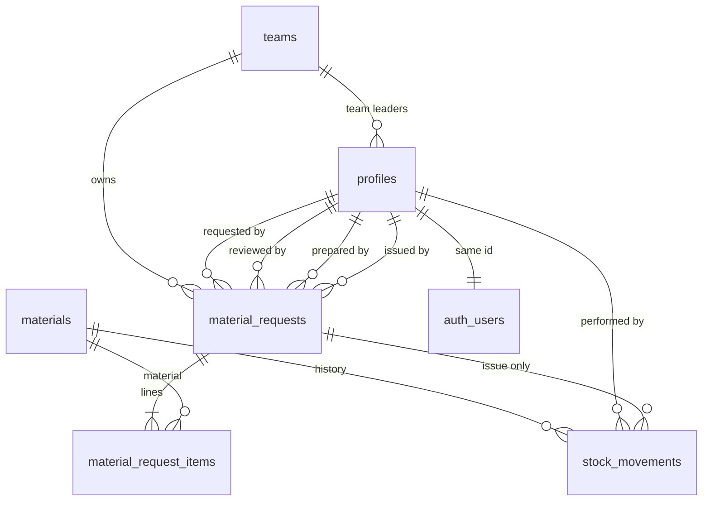
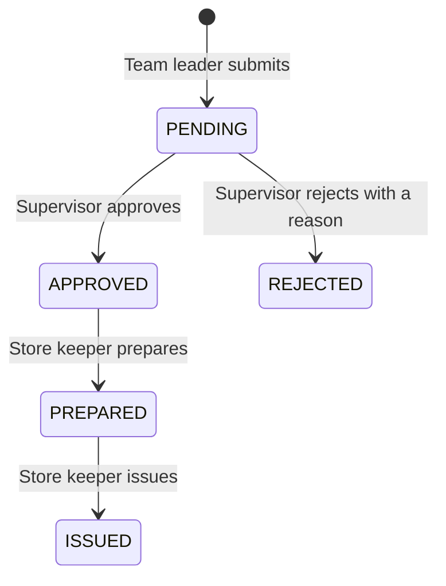

# Eagle Environmental Services – Material Request

Architecture for the first version. The application is not built yet.

This version covers four jobs only:

1. The store keeper keeps material stock and decides what teams can request.
2. A team leader requests materials for their own team.
3. A supervisor approves or rejects that request.
4. The store keeper prepares the approved request and issues it, which reduces stock.

## How the pieces fit

| Piece | Job |
| --- | --- |
| Next.js (App Router) + TypeScript | Pages, forms, and server actions |
| Tailwind CSS + shadcn/ui | Layout, buttons, inputs, and tables |
| Supabase Auth | Email and password login, session cookie |
| PostgreSQL (Supabase) | Tables, checks, and the functions that change data |
| Supabase Row Level Security | Who is allowed to read each row |
| Vercel | Hosts the Next.js app |

Vercel does not host the database. Supabase hosts Postgres and authentication. The Next.js app talks to Supabase with the public anon key and the signed-in user's session.

The browser is not the place that enforces the business rules. Pages hide buttons a person should not use. PostgreSQL functions are what actually approve, reject, prepare, issue, and change stock. Row Level Security is what stops a person from reading another team's request by typing its id into the address bar.

## Assumptions

- One company and one store. Each material has one quantity on hand.
- Each person has exactly one role.
- A team leader belongs to exactly one team. Supervisors and store keepers are not on a team. A supervisor can review every team's requests.
- A person cannot sign themselves up or choose their own role. An administrator creates the login in Supabase Auth, then inserts one `profiles` row with the role and, for a team leader, the team.
- A request is issued in full. There is no partial issue.
- Approval does not reserve stock. Two approved requests can ask for the same units. The first successful issue takes them. The second issue stops if the stock is no longer enough, and the request stays `PREPARED`.
- Quantities use up to two decimal places, so liters and kilograms work. The unit label (`pcs`, `L`, `kg`, `tube`) is text on the material.
- Requests and materials are not deleted. History stays in place. To retire a material, the store keeper turns off "requestable". To retire a person, the administrator disables their Auth login.

## Deliberate limits

These are left out so the first version stays small.

- Public sign-up, password reset screens, and a user-admin screen
- A screen for creating teams
- More than one store, stock reservations, and partial issuing
- A cancel button after approval
- Email or other notifications
- Dashboards, charts, barcodes, photos, suppliers, and purchase orders
- Editing a request after it leaves `PENDING`
- Deleting materials, requests, or stock history

If an approved request can no longer be issued because the stock was used or corrected, it stays `PREPARED`. The store keeper replenishes the stock and issues it. An administrator can correct a stuck row in SQL. A cancel-after-approval action can be added later if this happens often. It is not part of this version.

## 1. Application pages

There are eight screens. After login, the home page sends each role to the queue that is waiting on them.

| Route | Who | What the page does |
| --- | --- | --- |
| `/login` | Public | Email and password. No sign-up link. |
| `/` | Signed in | Sends a team leader to `/requests`, a supervisor to `/approvals`, and a store keeper to `/store/issues`. |
| `/requests` | Team leader | Lists their team's requests: number, date, status, and how many lines. All five statuses appear here. |
| `/requests/new` | Team leader | Lists materials that are requestable and have stock above zero. The team leader picks lines, enters quantities, and submits. That creates a `PENDING` request. |
| `/requests/[id]` | Whoever is allowed to see that request | Shows the lines, the status, and who performed each step and when. Actions on this same page depend on role and status. |
| `/approvals` | Supervisor | Default list is `PENDING`. A second filter shows requests already decided, so a supervisor can open one again. |
| `/store/stock` | Store keeper | Lists every material. Add a material. Set the counted quantity. Turn requestable on or off. |
| `/store/issues` | Store keeper | Default list is `APPROVED` and `PREPARED`. A second filter shows `ISSUED`. Each row opens `/requests/[id]`. |

Navigation:

- Team leader: Requests, New request
- Supervisor: Approvals
- Store keeper: To issue, Stock

The request detail page is shared so the status rules live in one place.

| Status on that request | Who is looking | What they can do |
| --- | --- | --- |
| `PENDING` | The team leader who created it | Change the lines and save. Saving keeps the status `PENDING`. |
| `PENDING` | Another team leader on the same team | Read it. |
| `PENDING` | Supervisor | Approve, or reject with a reason. |
| `APPROVED` | Store keeper | Mark prepared. Stock does not change. |
| `PREPARED` | Store keeper | Issue. Stock is reduced, or the issue is refused. |
| `REJECTED` | Anyone who can see it | Read it, including the reason. |
| `ISSUED` | Anyone who can see it | Read it. |
| Any later status | Team leader | Read it. The edit form is not shown. |

The detail page always shows the audit line for each step that has happened:

- Requested by, and when
- Reviewed by, when, and the rejection reason when the status is `REJECTED`
- Prepared by, and when
- Issued by, and when

The store view of a request also shows the quantity on hand beside each line, so a shortage is visible before Issue is clicked. The button still calls the database function. The screen is a preview. The function is the rule.

A team leader who opens another team's id, or a store keeper who opens a `PENDING` id, gets "not found". The page does not reveal that the row exists.

Suggested files when the app is built:

```text
app/login/page.tsx
app/(main)/layout.tsx
app/(main)/page.tsx
app/(main)/requests/page.tsx
app/(main)/requests/new/page.tsx
app/(main)/requests/[id]/page.tsx
app/(main)/approvals/page.tsx
app/(main)/store/stock/page.tsx
app/(main)/store/issues/page.tsx
lib/supabase/client.ts
lib/supabase/server.ts
supabase/migrations/0001_init.sql
```

Server Components read data. Server Actions call the database functions. There is no second copy of the rules in client state.

## 2. User roles and permissions

Roles are a column on `profiles`, not a separate permissions system. The three values are `SUPERVISOR`, `TEAM_LEADER`, and `STORE_KEEPER`.

| Action | Team leader | Supervisor | Store keeper |
| --- | --- | --- | --- |
| Sign in | Yes | Yes | Yes |
| See materials that are requestable and in stock | Yes | Yes | Yes |
| See the full catalog, including hidden and zero-quantity materials | No | Yes | Yes |
| See stock movement history | No | No | Yes |
| Create a request for their own team | Yes | No | No |
| See their team's requests | Yes | Yes, all teams | No, until the request is approved |
| See another team's requests | No | Yes | `APPROVED`, `PREPARED`, and `ISSUED` only |
| Edit lines while `PENDING` | Only the person who created that request | No | No |
| Approve | No | Yes, while `PENDING` | No |
| Reject with a reason | No | Yes, while `PENDING` | No |
| Prepare | No | No | Yes, while `APPROVED` |
| Issue and reduce stock | No | No | Yes, while `PREPARED` |
| Add a material, rename it, set the quantity, turn requestable on or off | No | No | Yes |
| Change anyone's role or team | No | No | No |

A team leader cannot approve their own request because a team leader is not a supervisor. The approve and reject functions still refuse when the signed-in person is the requester. That keeps the rule true even if a role is ever assigned badly.

Approved requests cannot be edited by team leaders. Issued requests cannot be edited by anyone. The only edit function updates lines while the status is still `PENDING`, and only for the requester. There is no function that changes lines after that, and direct table updates from the app are denied.

## 3. Database tables

Six tables. Text status and role columns use check constraints, which stay easy to read in the Supabase table editor.

Identifiers are `uuid` values generated by the database, except `material_requests.request_no`, which is a sequential number. Screens show it as `MR-1`, `MR-2`, and so on. The prefix is display only.

### `teams`

Team names. An administrator inserts rows. The app does not manage teams.

| Column | Type | Rule |
| --- | --- | --- |
| `id` | `uuid` primary key | Generated |
| `name` | `text` | Required, unique |
| `created_at` | `timestamptz` | Required, default `now()` |

### `profiles`

One row per login. `id` is the same value as `auth.users.id`.

| Column | Type | Rule |
| --- | --- | --- |
| `id` | `uuid` primary key | References `auth.users(id)` |
| `full_name` | `text` | Required |
| `role` | `text` | `SUPERVISOR`, `TEAM_LEADER`, or `STORE_KEEPER` |
| `team_id` | `uuid` | References `teams(id)`. Required for a team leader. Empty for the other roles. |
| `created_at` | `timestamptz` | Required |
| `updated_at` | `timestamptz` | Required |

```sql
check (
  (role = 'TEAM_LEADER' and team_id is not null)
  or (role in ('SUPERVISOR', 'STORE_KEEPER') and team_id is null)
)
```

The application never writes this table. Role changes happen in the SQL editor.

### `materials`

The catalog and the current quantity. The quantity column is the number the rest of the system trusts. History of how it changed lives in `stock_movements`.

| Column | Type | Rule |
| --- | --- | --- |
| `id` | `uuid` primary key | Generated |
| `name` | `text` | Required, unique |
| `unit` | `text` | Required. Examples: `pcs`, `L`, `kg` |
| `quantity_on_hand` | `numeric(12,2)` | Required, default `0`, must be `>= 0` |
| `is_requestable` | `boolean` | Required, default `true` |
| `created_by` | `uuid` | Required, references `profiles(id)` |
| `updated_by` | `uuid` | Required, references `profiles(id)` |
| `created_at` | `timestamptz` | Required |
| `updated_at` | `timestamptz` | Required |

A material is shown to team leaders on the new-request page when `is_requestable` is true and `quantity_on_hand` is greater than zero.

### `material_requests`

One header per request.

| Column | Type | Rule |
| --- | --- | --- |
| `id` | `uuid` primary key | Generated |
| `request_no` | `bigint` | Identity, unique. Displayed as `MR-{request_no}` |
| `team_id` | `uuid` | Required, references `teams(id)` |
| `requested_by` | `uuid` | Required, references `profiles(id)` |
| `status` | `text` | `PENDING`, `APPROVED`, `REJECTED`, `PREPARED`, or `ISSUED`. Default `PENDING` |
| `rejection_reason` | `text` | Required when status is `REJECTED`. Empty otherwise. |
| `reviewed_by` | `uuid` | References `profiles(id)`. Set when approved or rejected. |
| `reviewed_at` | `timestamptz` | Set together with `reviewed_by` |
| `prepared_by` | `uuid` | References `profiles(id)`. Set when prepared. |
| `prepared_at` | `timestamptz` | Set together with `prepared_by` |
| `issued_by` | `uuid` | References `profiles(id)`. Set when issued. |
| `issued_at` | `timestamptz` | Set together with `issued_by` |
| `created_at` | `timestamptz` | Required |
| `updated_at` | `timestamptz` | Required |

```sql
check (
  (
    status = 'REJECTED'
    and rejection_reason is not null
    and length(trim(rejection_reason)) > 0
  )
  or (status <> 'REJECTED' and rejection_reason is null)
)

check (reviewed_by is null or reviewed_by <> requested_by)
```

Status columns have to match the step. `PENDING` has no reviewer, preparer, or issuer. `APPROVED` and `REJECTED` have a reviewer and no preparer or issuer. `PREPARED` has a reviewer and a preparer, and no issuer. `ISSUED` has a reviewer, a preparer, and an issuer. Each of those timestamps is required when the matching person is set.

These columns are the request audit. Each step moves forward once, so one person and one time per step is enough. A separate audit table would copy the same facts.

### `material_request_items`

The lines on a request. Issuing uses `quantity_requested` as the amount to take. There is no second "quantity issued" column, because a request is issued in full.

| Column | Type | Rule |
| --- | --- | --- |
| `id` | `uuid` primary key | Generated |
| `request_id` | `uuid` | Required, references `material_requests(id)` |
| `material_id` | `uuid` | Required, references `materials(id)` |
| `quantity_requested` | `numeric(12,2)` | Required, greater than zero |

A material appears at most once on a request: unique `(request_id, material_id)`.

### `stock_movements`

Append-only history of quantity and availability changes. The app inserts rows. It never updates or deletes them.

| Column | Type | Rule |
| --- | --- | --- |
| `id` | `uuid` primary key | Generated |
| `material_id` | `uuid` | Required, references `materials(id)` |
| `movement_type` | `text` | `ADJUSTMENT`, `AVAILABILITY`, or `ISSUE` |
| `quantity_before` | `numeric(12,2)` | Required, `>= 0` |
| `quantity_after` | `numeric(12,2)` | Required, `>= 0` |
| `quantity_change` | `numeric(12,2)` | Required, and equal to `quantity_after - quantity_before` |
| `request_id` | `uuid` | References `material_requests(id)`. Set for `ISSUE` only. |
| `performed_by` | `uuid` | Required, references `profiles(id)` |
| `note` | `text` | Required, so the reason is stored with the person and the time |
| `created_at` | `timestamptz` | Required |

| Type | When it is written | Quantity | `request_id` |
| --- | --- | --- | --- |
| `ADJUSTMENT` | Store keeper sets a counted quantity, including opening stock | Change is not zero | Empty |
| `AVAILABILITY` | Store keeper turns requestable on or off | Before and after are equal, change is zero | Empty |
| `ISSUE` | Store keeper issues a request | Change is negative | The issued request |

### Indexes

- `material_requests (team_id, created_at desc)`
- `material_requests (status, created_at desc)`
- `material_request_items (request_id)`
- `stock_movements (material_id, created_at desc)`
- `profiles (team_id)`

### Delete behavior

Foreign keys use `restrict`, except request lines, which reference the request with `cascade` so a header and its lines stay together if an administrator ever removes a request in SQL. The app has no delete action. Disabling an Auth user is how a person loses access. Their profile and history remain so the "who did this" columns still resolve.

## 4. Relationships



- A team has many team-leader profiles, and many requests.
- A profile has a team only when the role is team leader.
- A request belongs to one team and one requesting profile.
- The same profile table is reused for the supervisor who reviewed it, the store keeper who prepared it, and the store keeper who issued it. Those three links are empty until that step happens.
- A request has one or more lines. A line points at one material.
- A material has many lines over time, and many stock movements.
- A stock movement points at the request only when the type is `ISSUE`.
- `profiles.id` and `auth.users.id` are the same person.

## 5. Request workflow



No other transitions exist. A rejected request stays rejected. An issued request stays issued. A team leader who needs a different approved request submits a new one.

### Create

`create_material_request(items jsonb)`

The JSON is a list of `{ "material_id", "quantity" }`.

The function checks all of the following, then inserts the header and the lines in one transaction:

- The caller is a team leader with a team.
- The list is not empty, and no material is repeated.
- Every quantity is greater than zero.
- Every material is requestable, and the quantity asked for is less than or equal to the quantity on hand at this moment.
- The header is `PENDING`, `team_id` is the caller's team, and `requested_by` is the caller.

The new-request page loads only materials that pass the same visibility rule. The function checks again so a crafted request cannot skip the page.

That check reads the stock at submit time. It does not hold the units. Stock can fall before issue. Issue is the step that is not allowed to pass a shortage.

### Edit while pending

`update_pending_request(request_id uuid, items jsonb)`

- The caller is the team leader who created the request.
- The status is `PENDING`.
- The new lines pass the same checks as create.
- The function replaces the lines and leaves the status, team, and requester unchanged.

Other team leaders on the same team can see the request and cannot change it.

### Approve

`approve_request(request_id uuid)`

- The caller is a supervisor, and is not the requester.
- The status is `PENDING`.
- The function sets `APPROVED`, `reviewed_by`, and `reviewed_at`.
- Stock does not change.

### Reject

`reject_request(request_id uuid, reason text)`

- The caller is a supervisor, and is not the requester.
- The status is `PENDING`.
- The reason is not blank after trimming.
- The function sets `REJECTED`, `rejection_reason`, `reviewed_by`, and `reviewed_at`.
- Stock does not change.

A blank reason fails in the function, and the table check would also reject the row. The screen should require a reason before it calls the function. The database still enforces it.

### Prepare

`prepare_request(request_id uuid)`

- The caller is a store keeper.
- The status is `APPROVED`.
- The function sets `PREPARED`, `prepared_by`, and `prepared_at`.
- Stock does not change. Preparation means the materials are being gathered. The hand-over is the issue step.

### Issue

`issue_request(request_id uuid)`

- The caller is a store keeper.
- The status is `PREPARED`.
- In the same transaction, the function locks the material rows in `material id` order, so two issues cannot both pass the stock check.
- For each line, if `quantity_on_hand` is less than `quantity_requested`, the function raises an error that names the material, the amount requested, and the amount available. The transaction rolls back. The status stays `PREPARED`. No movement is kept.
- Otherwise it subtracts the line quantity, inserts an `ISSUE` movement (negative change, `request_id` set, `performed_by` set, note set), then sets `ISSUED`, `issued_by`, and `issued_at`.

Locking in a stable id order also avoids two overlapping issues waiting on each other.

The `quantity_on_hand >= 0` check on `materials` is a backstop. The comparison inside the function is what returns a clear error.

## 6. Stock workflow

The store keeper is the only person who changes stock. Team leaders read the requestable quantity. Supervisors can read quantities while reviewing. Neither of those roles can write stock.

### Add a material

`create_material(name text, unit text, quantity numeric, is_requestable boolean, note text)`

- The caller is a store keeper.
- Name and unit are not blank. Quantity is zero or greater.
- The function inserts the material with `created_by` and `updated_by` set to the caller.
- When the opening quantity is greater than zero, it also inserts an `ADJUSTMENT` movement from `0` to that quantity.

A material with quantity zero can exist. Team leaders do not see it on the new-request page until the quantity is above zero and it is requestable.

### Rename or change the unit

`update_material_details(material_id uuid, name text, unit text)`

- The caller is a store keeper.
- Name stays unique.
- The function updates the name, the unit, `updated_by`, and `updated_at`.
- Quantity and requestable are unchanged, so no stock movement is written. The profile and timestamp on the material record who last edited the label.

### Set the counted quantity

`adjust_stock(material_id uuid, new_quantity numeric, note text)`

This is a count correction: a delivery arrived, stock was damaged, or the shelf was counted. It sets the quantity to the new number. It does not add a delta typed by the user, which is easier to get wrong.

- The caller is a store keeper.
- The new quantity is zero or greater, and the note is not blank.
- The function locks that material row.
- If the quantity is unchanged, it does nothing.
- Otherwise it inserts an `ADJUSTMENT` with before, after, change, `performed_by`, and the note, then updates `quantity_on_hand`, `updated_by`, and `updated_at`.

### Show or hide a material

`set_material_requestable(material_id uuid, is_requestable boolean, note text)`

- The caller is a store keeper.
- The note is not blank.
- If the flag is unchanged, it does nothing.
- Otherwise it updates the flag, `updated_by`, and `updated_at`, and inserts an `AVAILABILITY` movement with before and after equal to the current quantity.

Hiding a material does not change the quantity. An old request can still show the material name. A new request cannot include it, because create and update both require `is_requestable`.

### Issue

Described in the request workflow. It is the only stock path that writes `ISSUE`, and the only path that reduces quantity because of a request.

## 7. Security and Row Level Security

Two layers, with different jobs:

| Layer | Job |
| --- | --- |
| Row Level Security | Filters rows a signed-in person may read |
| Security definer functions | The only way to insert or update business data. Each function checks the caller's role, the current status, and the stock rule |

The Next.js app uses the anon key plus the user session. The service role key is not in the app, and it is not in any `NEXT_PUBLIC_` variable. Middleware sends a missing session to `/login`. The layout loads the profile and, if the administrator has not added a profile yet, shows that the account is not set up.

Hiding a button is not security. A person can call Supabase directly. Reads that the policies do not allow return no rows. Writes that are not one of the functions below are denied.

### Helper

`current_profile()` returns the profile for `auth.uid()`. Policies on other tables use it to read the caller's role and team. It is `security definer` with `search_path = public`, so it does not recurse through the profiles policy. It returns only the caller's row. `authenticated` may execute it.

### Read policies

Enable RLS on every table. `anon` has no policies, so a logged-out request sees nothing.

| Table | Team leader | Supervisor | Store keeper |
| --- | --- | --- | --- |
| `teams` | All rows | All rows | All rows |
| `profiles` | All rows | All rows | All rows |
| `materials` | Requestable and quantity above zero, plus any material already on their team's requests | All rows | All rows |
| `material_requests` | `team_id` equals their team | All rows | Status is `APPROVED`, `PREPARED`, or `ISSUED` |
| `material_request_items` | Lines whose parent request is visible | Lines whose parent request is visible | Lines whose parent request is visible |
| `stock_movements` | No rows | No rows | All rows |

Item visibility reuses the request policy: a line is visible when its parent request is visible to the same person. The request policy does not query the items table, so the two policies do not call each other in a loop.

Profiles are readable by every signed-in user so request screens can show names. This is an internal company tool. Email stays in Supabase Auth and is not copied into `profiles`.

The material exception for old requests is what keeps a name on a historical line after the store keeper hides the material or the quantity hits zero. The create function still refuses a new line for a material that is hidden or out of stock.

### Write access

`authenticated` and `anon` do not receive insert, update, or delete grants on these tables. There are no insert or update policies for normal client writes.

Every function is `security definer`, sets `search_path = public`, checks `auth.uid()` against `profiles`, and raises a clear error when the role or the status is wrong. Execute is granted to `authenticated` only.

| Function | Caller | Effect |
| --- | --- | --- |
| `create_material` | Store keeper | Inserts a material and optional opening adjustment |
| `update_material_details` | Store keeper | Changes name and unit |
| `adjust_stock` | Store keeper | Sets quantity and writes `ADJUSTMENT` |
| `set_material_requestable` | Store keeper | Sets the flag and writes `AVAILABILITY` |
| `create_material_request` | Team leader | Inserts `PENDING` header and lines |
| `update_pending_request` | The requester, while `PENDING` | Replaces lines |
| `approve_request` | Supervisor, not the requester, while `PENDING` | Sets `APPROVED` |
| `reject_request` | Supervisor, not the requester, while `PENDING`, reason required | Sets `REJECTED` |
| `prepare_request` | Store keeper, while `APPROVED` | Sets `PREPARED` |
| `issue_request` | Store keeper, while `PREPARED`, stock must cover every line | Sets `ISSUED` and writes `ISSUE` movements |

`approve_request` shows the shape. The other status functions follow it.

```sql
create or replace function approve_request(p_request_id uuid)
returns void
language plpgsql
security definer
set search_path = public
as $$
declare
  v_profile profiles;
  v_request material_requests;
begin
  select * into v_profile from profiles where id = auth.uid();

  if v_profile.role is distinct from 'SUPERVISOR' then
    raise exception 'Only a supervisor can approve a request';
  end if;

  select * into v_request
  from material_requests
  where id = p_request_id
  for update;

  if not found then
    raise exception 'Request not found';
  end if;

  if v_request.requested_by = v_profile.id then
    raise exception 'You cannot approve your own request';
  end if;

  if v_request.status is distinct from 'PENDING' then
    raise exception 'Only a pending request can be approved';
  end if;

  update material_requests
  set
    status = 'APPROVED',
    reviewed_by = v_profile.id,
    reviewed_at = now(),
    updated_at = now()
  where id = p_request_id;
end;
$$;
```

`issue_request` is the stock guard. After the role and status checks, it locks the materials, then decrements or aborts the whole transaction:

```sql
select id
from materials
where id in (
  select material_id
  from material_request_items
  where request_id = p_request_id
)
order by id
for update;

-- For each locked material:
--   if quantity_on_hand < quantity_requested, raise and roll back
--   else subtract, and insert an ISSUE movement
-- Then set the request to ISSUED
```

### Accounts

There is no sign-up page. An administrator:

1. Creates the user in Supabase Authentication.
2. Inserts the team, if it is new.
3. Inserts `profiles` with that user's id, full name, role, and team id when the role is team leader.

Role is not taken from sign-up metadata. A person must not be able to mark themselves as a supervisor.

### Rules to test when the app is built

- A team leader's request list and a direct read by id return only their team's rows.
- A team leader's new-request list omits hidden materials and zero quantities.
- Calling `approve_request` as a team leader fails, including for their own request.
- `reject_request` with a blank reason fails, and a rejected row cannot be stored without a reason.
- A team leader's update fails once the status is `APPROVED`, `PREPARED`, `ISSUED`, or `REJECTED`.
- A direct table update of `status` or `quantity_on_hand` from the client fails.
- Two issue attempts that overlap cannot drive a quantity below zero. The second attempt rolls back and leaves the request `PREPARED`.
- An `ISSUE` movement and the request's `issued_by` / `issued_at` are written together, or not at all.
- A store keeper does not see `PENDING` or `REJECTED` requests.
- A supervisor's stock function calls fail.

## Build order, when implementation starts

1. Migration: tables, checks, indexes, RLS, and the ten functions.
2. Login, profile load, and redirect by role.
3. Stock page, so materials exist.
4. New request and the team leader list.
5. Approval and rejection on the shared detail page.
6. Prepare and issue, including the shortage error.
7. The audit lines on the detail page for every role that can open it.

Environment variables for the app will be `NEXT_PUBLIC_SUPABASE_URL` and `NEXT_PUBLIC_SUPABASE_ANON_KEY`.
